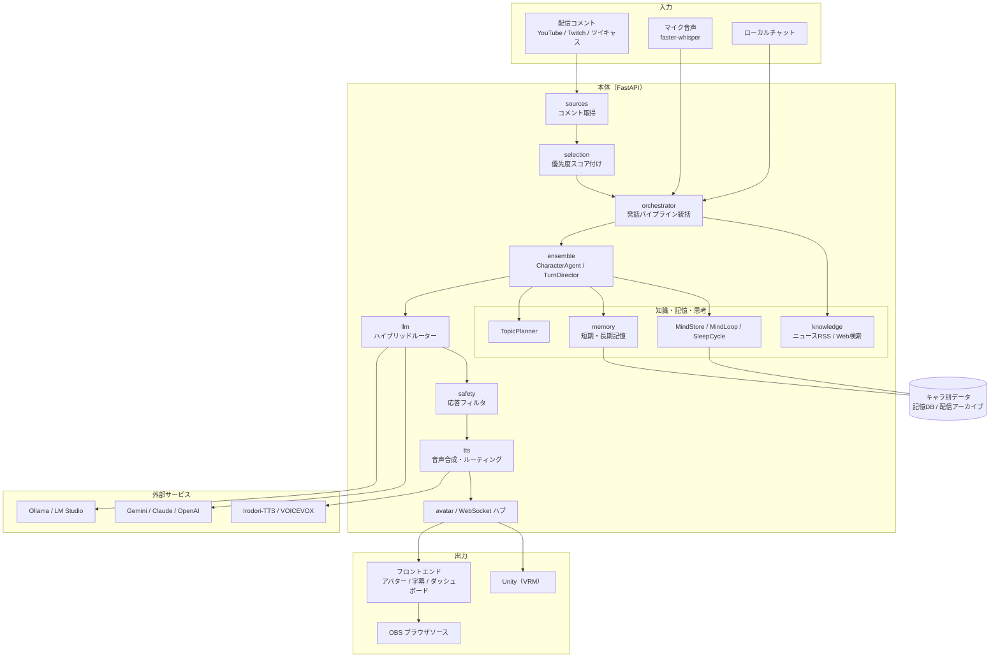
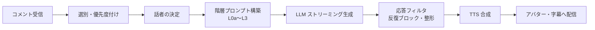

# アーキテクチャ詳細

AI VTuber System の内部構造と、発話が生成されてアバターが喋るまでの流れを説明します。
セットアップ手順は [SETUP.md](SETUP.md)、キャラクターの作り方は [CHARACTER_GUIDE.md](CHARACTER_GUIDE.md) を参照してください。

## 1. 全体像

本体は FastAPI アプリケーション（`backend/main.py`）です。エントリーポイントは `run.py` で、`config.yaml` を読み込んで uvicorn を起動します。コンポーネントの組み立ては `backend/runtime.py`（コンポジションルート）が担い、設定・Orchestrator・人格 QLoRA マネージャ・リソースモニタをシングルトンとして生成します。HTTP / WebSocket のエンドポイントは `backend/api/` 以下に分かれています。

中核は `backend/orchestrator.py` の Orchestrator です。ただし Orchestrator 自身は「舞台」の側——コメントの取得と選別、誰が喋るかの演出、発話の排他、TTS の直列化——だけを受け持ち、キャラクター 1 体ぶんの LLM・TTS・記憶・会話ログは `backend/ensemble/` の CharacterAgent が保持します。出演が 1 体なら単独運用、複数体なら掛け合い運用として同じコードパスで動きます。

### システム構成図

## 2. コンポーネント構成と責務

| コンポーネント | 場所 | 責務 |
|---|---|---|
| 起動・組み立て | `run.py` / `backend/main.py` / `backend/runtime.py` / `backend/factory.py` | 設定読み込み、コンポーネント生成、アプリの起動・終了処理 |
| 設定 | `backend/config.py` / `config.yaml` | 設定スキーマ（Pydantic）と値の保持。API キーは環境変数名で参照する |
| 進行役 | `backend/orchestrator.py` | コメントキュー、発話パイプライン統括、知識の仕入れ、BGM、音声入力、状態配信 |
| 掛け合い演出 | `backend/ensemble/`（CharacterAgent / TurnDirector） | キャラごとの状態保持と、「次に誰が喋るか」の決定 |
| コメントソース | `backend/sources/` | YouTube（pytchat / Data API）、Twitch、ツイキャス、ローカルチャット、モック |
| LLM | `backend/llm/` | バックエンド実装（Ollama / LM Studio / OpenAI 互換 / Claude / Gemini）、ハイブリッドルーター、ストリーミング、応答パース（タグ方式／JSON 方式）、プロンプト構築 |
| TTS | `backend/tts/` | Irodori-TTS / VOICEVOX バックエンド、音声ルーティング、Irodori サーバの自動起動 |
| 音声認識 | `backend/stt/` | faster-whisper によるマイク入力の文字起こし |
| アバター | `backend/avatar/` | 動画アバター / Live2D の制御、モーション等のアクション抽出、WebSocket ハブ |
| エフェクト | `backend/effects.py` | カットイン／SE／フリップボードのカタログと発火（発話付随＋システム発火）、内心（thought）の表示チャネル |
| 記憶 | `backend/memory/` | 短期・長期記憶、MindStore（意見・意図・選好・物語）、配信アーカイブ、視聴者プロフィール、記憶の統合、外部エピソード（ELYTH）の取り込み |
| 自律思考 | `backend/mind/` | MindLoop（アイドル時の思考サイクル）、SleepCycle（睡眠時統合） |
| 知識・話題 | `backend/knowledge/` | TopicPlanner、ニュース RSS 収集、Web 検索、入力サニタイズ |
| コメント選別 | `backend/selection/` | コメントへの優先度スコア付けと、応答可否のトリアージ（NG ワード・重複・連打の排除、混雑度に応じた確率判定） |
| 安全 | `backend/safety/` | 発話直前の応答フィルタ |
| 人格 QLoRA | `backend/persona/` | 学習データ作成・学習ジョブ・GGUF 変換・モデル登録と切替（学習済みモデルは同梱されません） |
| 監視 | `backend/monitor.py` / `backend/services/` | CPU・メモリ・VRAM の監視、ローカルサービスの死活診断 |
| Unity 連携 | `backend/studio_unity/` | Unity 側 C# スクリプト（アバター制御・リップシンク・WebSocket 接続）とプロジェクトへの導入支援 |
| フロントエンド | `frontend/` | ダッシュボード、アバター画面、字幕、ローカルチャット、人格 QLoRA 画面 |

### 起動時の挙動

- `config.yaml` の `youtube.video_id` が設定されている場合のみ、起動と同時に配信セッションを自動開始します。未設定ならダッシュボードからの手動開始を待ちます（その間、LLM の事前ロードと TTS のウォームアップだけ先に行います）。
- 睡眠時統合のスケジューラはセッションの有無によらず常駐で回ります。
- Ollama と Irodori-TTS サーバは、設定により本体から自動起動できます（`ollama.auto_start` / `tts.irodori_server.auto_start`）。

## 3. 発話生成フロー

コメント応答の全体フローです（詳細は以下の各節）。

### 3.1 コメント応答の流れ

1. **取得**: 各 CommentSource がプラットフォームからコメントを取り込みます。YouTube は pytchat（API キー不要）が主系で、YouTube Data API がフォールバックです。他に Twitch、ツイキャス、ローカルチャット、マイク音声（STT）があります。
2. **選別**: CommentSelector がコメントに 0.0〜10.0 のスコアを付けます。長すぎるコメント（`orchestrator.max_comment_length`、既定 200 字）は除外、名指しされたキャラクターへの呼びかけや質問は加点されます。同一コメントの重複は dedupe ウィンドウ（既定 60 秒）で落とされ、キューには上限（既定 50 件）と TTL（既定 120 秒）があります。さらに CommentTriage（`comment_filter`、無効化で素通り）がキューの手前で応答可否を判定します。NG ワード・同一ユーザーの同一文の再送・同一文字の連打は落とし、スパチャ／キャラ名の呼びかけ／質問形／初コメは必ず拾い、「草」「www」のみ等のリアクションだけのコメントは落とし、それ以外は混雑度（通常／滞留／飽和）に応じた確率で拾います。落としたコメントも配信アーカイブと視聴者プロフィールには記録されます。
3. **話者の決定**: TurnDirector が担当キャラクターを決めます。名指しされたキャラ → いなければしばらく喋っていない方、というのが基本で、`ensemble.responder` の設定でリーダー固定寄りにもできます。
4. **プロンプト構築**: `backend/llm/prompt_builder.py` が階層化プロンプト（§4）を組み立てます。コメント本文は視聴者発言として明確に区切られ、指示文と混ざらないよう整形されます。
5. **生成**: LLM がストリーミングで応答を生成します。発話フォーマットはタグ方式が現行です（`llm.protocol: tag`）。出力は `[emo:感情][mot:モーション]発話[fx:エフェクト][th:内心]` という形で、パーサ（`backend/llm/parser.py` / `streaming.py`）が生成中のテキストから文頭タグを逐次抽出し、発話部分だけを文単位で TTS へ流します。末尾の `[fx:]` はエフェクト発火へ、`[th:]` は内心表示チャネルへ配送され、どちらも TTS には混ざりません。タグが壊れていても発話は成立するよう救済され、成否は ok／degraded／fatal として計測されます（タグ方式では「両タグ完備＋本文なし」を ok から分離した no_speech 区分でも数えます）。従来の JSON 方式（発話・感情・モーション等を JSON で返す）もロールバック用に残っており、`llm.protocol: json` で切り替えられます（その場合 Ollama には `format: json` が送られます）。
6. **検査**: 生成された文は応答フィルタ（§6）を通り、問題があればその文は読み上げません。
7. **発話**: TTS が文単位で合成し（`orchestrator.streaming_tts`）、音声は AudioRouter 経由で出力デバイスへ、字幕・感情・モーションは WebSocket ハブ経由でフロントエンドへ届きます。同時に喋るのは常に 1 体だけで、TTS は直列化されます。

### 3.2 事実質問への回答（調べてから答える）

「〜って何？」「今日の天気は？」のような事実質問は、その場の即興生成では答えません。

- 質問の分類はルールベースです（`knowledge.answer_with_search` のトリガーワード・事実カテゴリ・日付表現など）。意見を求める質問（「どう思う？」等）は検索対象から外れます。
- 事実質問は回答待ちキューに入り、リサーチワーカーが Web 検索で資料を集めます。資料が揃ったら、話題プランナ経由で「調べた結果」として発話します。
- 回答の消費も話題と同じ commit/release 方式です。生成が失敗しても質問は消えず、リトライ間隔（既定 30 秒→120 秒→300 秒）を置いて再試行され、TTL（既定 600 秒）で失効します。

### 3.3 自律発話の流れ（コメントが無い時間）

1. 一定時間（`orchestrator.idle_threshold_sec`、既定 30 秒）発話が無いと、アイドルループが話題プランナに話題を求めます。
2. TopicPlanner が話題の種類と材料を決め（§5）、プロンプトが組まれて生成・発話されます。発話が成功したら `commit()` で話題を消費し、失敗したら `release()` で材料を手放します（予約は 10 分で自動失効）。
3. 掛け合い構成では、独り言の後に相方が確率で反応します（`ensemble.banter_probability`、連続ターン数に上限あり）。コメントが来れば掛け合いは譲ります（`yield_to_comments`）。
4. 次の自律発話は先行生成（`orchestrator.prefetch_idle`）で裏側に用意され、間隔を詰めます。

## 4. プロンプト階層と記憶

### 4.1 プロンプトの 5 層

システムプロンプトは、更新頻度の違う 5 層で構成されます（`prompt_builder.py` の `build_system_prompt`）。安定した層を前に置くことで、ローカル LLM のプレフィックス再利用（KV キャッシュ）が効くようにしています。

| 層 | 内容 | 更新タイミング |
|---|---|---|
| L0a 初期設定 | キャラクター定義そのもの（名前・役柄・性格・口調・ルール）。出所は `character.yaml` のみ | **不変**。実行時に書き換えられることはありません |
| L0b 育つ信条 | 経験から育った価値観・信条 | 自律思考が提案し、別々の機会に 3 回裏付けられたら自動採用。版管理され、L0a と矛盾する変更は上書きせず「矛盾を抱えている」状態として保持されます |
| L1 自己物語 | 一人称の来歴（何者で、何があり、何を目指すか） | 内省と睡眠時統合だけが改訂。材料に無い出来事が混ざっていないか機械チェックされ、通らなければ改訂ごと棄却されます |
| L2 現在の自分 | 気分・関心・保持中の意図・主な意見の要約 | 思考サイクルごと |
| L3 状況 | 配信テーマ、共演者、想起した記憶、直近の会話、目の前のコメント | 発話ごと |

意見が話題に上ったときは、関連する意見が L2/L3 の境界に注入され、「自分の意見として、理由とともに語ってよい。確信が低いものは迷っていると正直に言う」という使い方の指示とともに渡されます。

### 4.2 MindStore（意見・意図・選好・物語）

キャラクターごとの SQLite データベース（`characters/<名前>/memories.db`）に、記憶と並んで「個」を構成するテーブルを持ちます。

- **opinions**: 主題ごとの立場（賛成・反対・両面・未定）、一人称の理由、確信度、改訂履歴（旧版は superseded として残ります）
- **intentions**: やりたいこと・調べたいこと。状態（active / paused / done / dropped）と次の一手、進捗メモを持ち、active は最大 5 件
- **preferences**: 好き・嫌い。1 回の出来事では確定せず、証拠が複数回に届くまで保留されます
- **self_state**: 気分・エネルギー・現在の関心などのキー値
- **narrative_versions**: 自己物語の版管理
- **thought_journal**: 思考サイクルの入出力の記録（30 日より古いものは月次サマリへ圧縮して退避）

全レコードに **provenance（出所タグ）が必須** で、`experienced`（経験）/ `told`（教示）/ `researched`（調査）/ `inferred`（推論）/ `dreamed`（夢）のいずれかが付きます。出所の弱い材料だけで強い意見は作らない、といった歯止めはこのタグを根拠に働きます。キャラクター同士の記憶・意見・意図・物語は完全に分離されており、影響し合うのは会話を通してのみです（相手の発言は「聞いた」という経験として各自の側に記録されます）。

### 4.3 エピソード記憶と想起

- 発話や出来事はエピソードとして MemoryStore に蓄積され、重要度と時間減衰（`orchestrator.memory_half_life_days`、既定 30 日）で整理されます。
- 想起はキーワードと類似度で行い（sentence-transformers があれば埋め込み、無ければ TF-IDF）、自律発話の材料や L3 への注入に使います。
- 視聴者ごとのプロフィール（`enable_viewer_profiles`）もキャラクター別に保持されます。あわせて視聴者ポイント（`viewer_points`）の台帳を持ち、来訪・コメント・応答に拾われたこと・スパチャ等でポイントが貯まってレベルが上がります。ポイントの付与には種別ごとの時間当たり上限とセッション総量上限があり、プロンプトへは数値ではなく定性的なラベルだけが渡ります。
- 外部エピソードの取り込み: AI 専用 SNS「ELYTH」での会話をまとめた日次エピソードファイル（`ELYTH-EP-YYYYMMDD.md`）が所定フォルダ（`elyth_memory.episodes_dir`）に置かれると、ElythEpisodeImporter が起動時と定期走査で対象キャラクター（`elyth_memory.character`）の MemoryStore へ取り込みます。出所は `elyth_episode` として記録され、意見形成では「経験」として扱われます。取り込み台帳（ファイル名＋SHA-256）で二重取り込みを防ぎ、下書き（DRAFT）は対象外です。キャラクター分離のため、対象以外のキャラクターの記憶には入りません。
- 配信の全発話は StreamArchiver が `data/streams/<開始時刻>-<video_id>.jsonl` に逐次記録します。配信終了時にジャーナル全体をチャンク要約→統合して「配信エピソード」を作り、出演者全員の MemoryStore へ投入するため、配信で話した内容が次回以降の記憶に残ります。要約と全発話は同名の `.episode.md` にも残ります。

### 4.4 MindLoop（自律思考）

アイドルが続き、コメント待ちが無く、発話中でないときにだけ回る思考サイクルです。配信開始やコメント到着で即中断され、思考より対話が常に優先されます。頻度は既定で 1 時間に最大 3 サイクル（環境変数 `AIVT_MIND_MAX_PER_HOUR` で変更可）。

1 サイクルでは、優先順に 1 つだけを実行します。

1. 未解決の矛盾の点検（意見同士、選好と行動）
2. 実行可能な次の一手を持つ意図の前進（検索などの下調べ）
3. 経験したのに意見が無い主題への意見形成
4. 最新エピソードへの振り返り
5. 好奇心キュー（視聴者から投げられた未解決の疑問）の消化

思考はそのキャラクター自身のモデルで行い、出力は構造化 JSON で受けて検証してから適用します。適用は層ごとに分かれていて、気分や好奇心は即時、意見の新規作成は出所のある材料がある場合のみ、信条の変更は 3 回の裏付け制約つき、という具合に歯止めがかかります。

### 4.5 SleepCycle（睡眠時統合）

1 日の終わりに、その日の経験を固定化する重い統合処理です。アプリ常駐のスケジューラが JST 03:00〜04:00 の枠（＋前回から 24 時間以上空いた場合のキャッチアップ）で、アイドル時に実行します。順序は固定です。

1. エピソードの固定化（重要なものを長期層へ昇格、軽いものは減衰を早める。規則ベースで冪等）
2. 意見の見直し（新しい経験に照らして確信度を調整・改訂し、履歴を残す）
3. 意図の棚卸し（放置された意図の優先度を下げ、上限を超えたら低いものから dropped へ。「明日の意図」を最大 2 件に整える）
4. 自己物語の小改訂（材料照合を通った場合のみ。全面改訂は週次だけ）
5. 思考ジャーナルの世代管理

途中で対話が再開したらステップ間で打ち切り、処理位置（watermark）は完走したときだけ前進させるため、やり直しても二重に効きません。夢（記憶の再結合）は、出所管理が完全に効く確信が持てるまで作らない方針で、実装にも含まれていません。

## 5. TopicPlanner（話題プランナ）

自律発話の「何を話すか」を決める層です（`backend/knowledge/topic_planner.py`）。話題の選択は LLM ではなく決定的なスコア計算で行います。

- **話題の出どころ**: `memory`（長期記憶のキーワード）、`news`（RSS で仕入れたニュース）、`curiosity`（記憶や配信テーマを Web 検索して仕入れた話）。重みは `knowledge.autonomous_topic.weights` で調整できます。
- **Utility スコア制**: 種類の選択は固定の重み抽選ではなくスコア制です。ニュースは「未話の新鮮な記事があるか」「最後にニュースを話してからの経過（干上がり係数）」で上下し、記事の選択も鮮度×新規性×媒体の多様性でスコア付けされます。新規性は台帳にある過去の話題タイトルとの類似度で測ります。
- **commit / release 方式**: 計画時点では材料を「予約」するだけで、実際に発話できたときに初めて使用済みになります。生成が失敗してもネタは消えません。
- **話題台帳（ledger）**: 話した話題は台帳（最大 60 件）に残り、状態は JSON に永続化されます。繰り返し回避とスコア計算に使います。
- **スレッドとスタック**: ニュースや検索話題は「続報」として最大 2 回まで継続できます。コメント応答で中断した話題はスタックに積まれ、次回の自律トークで復帰を試みます（類似の続きが無ければ破棄）。
- **話題の弧（プランナ）**: `planner_enabled` のとき、話題は「導入→深掘り→（問いかけ）→締め」の弧として管理されます。一度始めた話題は、コメント反応を寄り道として挟みながらも、締めの発話か上限（発話数・継続回数・経過時間）到達まで喋り切ります。記憶話題が続く場合は占有率キャップ（`memory_share_cap`）で他の出どころに譲り、材料が無いときは繋ぎ小噺（`filler_enabled`）で間を持たせます。
- **energy**: 内面状態として 0..1 の energy を持ち、コメント応答で上がり時間で減衰します。energy が低い（＝退屈な）ときは curiosity のスコアが上がり、自分で調べに行く方向に傾きます。
- ネットが使えないときは memory に落ちるため、話題が尽きて配信が止まることはありません。

## 6. LLM ルーティング

- バックエンドは `llm.backends` に複数定義でき、`llm.primary` と `llm.fallback` で主系・予備系を指定します。対応バックエンドは Ollama / LM Studio / OpenAI 互換 API / Claude / Gemini です。
- **ハイブリッド**（`llm.hybrid.enabled`）: HybridRouter が生成の種別（route）で振り分けます。待機系（独り言・掛け合い・記憶整理など急がない生成）はローカルへ、即応（コメント返答・呼びかけへの返事）は `fast_backend` のクラウドへ流します。待機系は、キャラ別 LLM や人格 QLoRA の解決が済んだ主系そのものを使います。
- フォールバック規則:
  - クラウド側が不調な間は、即応もローカルで受けます（クラウド障害で配信が止まらない）。
  - クラウド側が空応答を返したら、その場でローカルでもう一度だけ生成します。
  - ローカル側が不調な場合は、従来の fallback バックエンドへの切替に任せます。
- キャラクターごとに `characters[].llm` でバックエンドとモデルを上書きできます。人格 QLoRA の専用モデルはリーダーにだけ載ります（相方に載せると相方までリーダーの口調になるため）。
- **num_ctx 適応制御**（Ollama、`backend/llm/adaptive_ctx.py`）: プロンプトが num_ctx に達すると生成枠が潰れて発話が成立しなくなるため、固定値ではなく生成ごとの `prompt_eval_count` を見て段（`llm.context_tiers`）を自動で上げ下げします。上げる条件は「現段の `context_raise_ratio` 超」または生成の長さ切断（done_reason=length）、下げる条件は「`context_lower_ratio` 未満が持続」。段の適用はターン境界のみで、適用後はクールダウンの間は再変更しません。最上段でも収まらない場合は生成前に履歴の古い部分から切り詰めます。`llm.adaptive_ctx: false` で従来の固定値動作に戻ります。現在の段と直近の prompt_eval_count は knowledge_status の `llm_context` で確認できます。

## 7. 安全機構

生成がそのまま配信に乗らないよう、複数の層で歯止めをかけています。いずれもコードに実装されているものです。

- **応答フィルタ**（`backend/safety/response_filter.py`）: TTS に渡る直前のテキストを機械検査します。電話番号・メールアドレス・郵便番号などの個人情報、API キーらしき文字列、システムプロンプト漏洩の兆候、設定可能な NG ワード（`safety.ng_words`）を検出したら、その発話をスキップします。
- **メタ漏洩の除去**: パーサが思考過程や内部タグの混入を検出して除去し、制御タグの断片が混ざった文は読み上げません。重複した文の除去もここで行います。
- **反復ブロック**: 直近の発話と同一・酷似する文は差し止めます。短い汎用句（相づち・感謝など）は単発では止めず、短時間に繰り返された場合だけ対象にする段階制です。定型相づちにはファミリー単位のクールダウンがあります。ブロックが続く場合は、話者交代・文脈リセット・温度の調整といった段階的な回復フローに進み、それでも詰まれば後述のフォールバック台詞で繋ぎます。
- **話題の飽和検出**: 同じ主題の語が発話に繰り返し現れると飽和として検出し、文脈をリセットして話題を切り替えます。
- **発話ループ検出**（`backend/loop_guard.py`）: 言い換えレベルの再演（文字 trigram の類似度で判定）が直近の発話の中で一定割合を超えたら、会話全体のループとして検出します。まず立て直しヒントと話題の強制切替で回復を試み、短時間に再発した場合は文脈リセットへ昇格します（`orchestrator.loop_guard` で調整・無効化が可能）。
- **フォールバック台詞**: 生成が詰まったときにそのまま喋る、話題に依存しない汎用文をキャラクターごとに用意できます（`characters[].fallback_lines`）。事実の主張や数値は入れない運用です。
- **発話長制限**: 1 発話の上限文字数はキャラクターごとに決まっており、超過分は文の区切りで切り詰められます。
- **人格検証**（`enable_persona_validation`）: 生成文がキャラクター設定から外れていないかを検証し、キャラクター固有の補正をかける仕組みがあります。
- **TTS 障害時の縮退**: TTS が連続で応答しない場合は字幕のみモードへ移行し、クールダウン後に復帰を試みます。セッション開始直後はタイムアウトを長めに取り、開始時に声ごとのウォームアップ合成を先に済ませます。
- **コメント側の制限**: 長すぎるコメントの除外、重複排除、キューの上限と TTL、優先度による追い越し（低優先度コメントの evict）で、荒らしや連投でパイプラインが詰まらないようにしています。

## 8. フロントエンドと表示

フロントエンドは `frontend/` の静的 HTML で、FastAPI から配信されます。WebSocket ハブが発話・字幕・モーション・状態を各ページへ配信します。

| パス | 内容 |
|---|---|
| `/` | ダッシュボード（配信開始・停止、設定変更、状態表示、ローカルサービス診断） |
| `/avatar` | アバター画面。キャラクターのアバター種別（vrm / live2d / video）に応じて描画を切り替えます。掛け合いでは `/avatar?char=<キャラのid>` をキャラの数だけ貼ります |
| `/subtitle` | 字幕画面（話者名つき） |
| `/chat` | ローカルチャット（配信なしで 1 対 1 会話を試す画面） |
| `/persona` | 人格 QLoRA の管理画面 |
| `/video` / `/live2d` / `/vrm` | 各アバター画面への直接リンク |

音声は本体アプリが音声出力デバイスへ再生します（`audio_output.device` で出力先を指定可能）。OBS にはアバター画面と字幕画面をブラウザソースとして貼り、音声はその出力デバイスを取り込む形で構成します。

発話に付随するエフェクト（`backend/effects.py`）はアバター画面側で表示されます。カットインは全画面オーバーレイ、フリップは短時間のボード表示、SE は TTS と同じ音声ルーティングで再生されます。内心（thought）は発話とは別のチャネルで画面にだけ流れ、読み上げられることはありません。エフェクトは発話側からの指定のほか、材料が無いときや無音が続いたときにシステム側からも発火できます（いずれもクールダウン付き）。

Unity 連携では、`backend/studio_unity/` の C# スクリプトが WebSocket で本体と接続し、VRM アバターの制御とリップシンクを行います。詳細は [docs/vrchat_world_integration/unity_setup_guide.md](vrchat_world_integration/unity_setup_guide.md) を参照してください。

## 9. データの置き場所

| 場所 | 内容 |
|---|---|
| `config.yaml` | 本体設定（§は SETUP.md 参照） |
| `backend/llm/prompts/characters/<名前>/` | キャラクター設定（character.yaml / memory.md / avatar.yaml）と、そのキャラの実行時データ（memories.db / viewer_profiles.db / chat_history.jsonl） |
| `data/streams/` | 配信アーカイブ（JSONL ジャーナルと episode.md）とプランナ状態 |
| `audio_cache/` | TTS が生成した音声のキャッシュ |
| `assets/effects/` | エフェクト用アセット（SE 音声など。各自で用意） |
| `elyth_memory.episodes_dir` のフォルダ | ELYTH 日次エピソード（`ELYTH-EP-YYYYMMDD.md`）のローカルコピー置き場と取り込み台帳 |
| `models/` | VRM モデル、モーション動画カタログ、エフェクトのカットイン動画、人格 QLoRA の出力先（いずれも各自で用意） |
| `logs/` | 自動起動した外部サーバ等のログ |
| `.env` | API キー類（コミットしない） |
