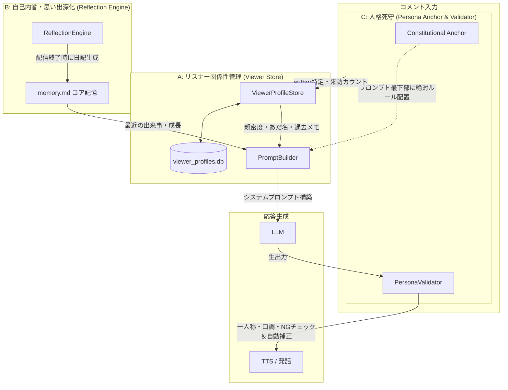

# 長期記憶保持＆人格維持システム (A・B・C統合) 実装計画

## 概要
AI VTuberが「何ヶ月もリスナーを覚え続け」「配信を通じて自身の思い出を深め」「どれだけ記憶が増えても絶対にキャラが崩れない」を実現するため、以下の3軸（A・B・C）をバランスよく統合したメモリ＆ペルソナ維持システムを構築します。

- **A: リスナーとの関係性（Viewer Entity & Relationship Memory）**
- **B: キャラクター自身の人生・思い出（Reflection & Diary Engine）**
- **C: 口調や世界観の死守（Constitutional Persona Guard & Validator）**

---

## 全体アーキテクチャ

---

## 変更・追加するファイル

### 1. 新規モジュール
1. **`backend/memory/viewer_store.py` (新規)**
   - 視聴者ごとのプロファイル（来訪回数、初回・最終来訪日、親密度レベル1〜5、過去の話題メモ、あだ名）をSQLiteで永続管理。
   - コメント受信時に親密度と要約メモを取得し、コンテキストに渡す形式に整形。
2. **`backend/memory/reflection_engine.py` (新規)**
   - 配信終了時（または一定周期）に、その日の会話ログとエピソード記憶から「AI自身の日記・思い出（Reflection）」を生成。
   - キャラクターの視点で「今日あった楽しかったこと・気づき」を要約し、`memory.md`（コア記憶）に自動蓄積（直近N日分をローテーション）。
3. **`backend/llm/persona_validator.py` (新規)**
   - 生成されたテキストの発話前検証器。
   - 一人称（例：「わらわ」「わたし」）の逸脱検知と自動補正、禁止口調の修正、キャラ崩壊時のフォールバック。

### 2. 既存モジュールの改修
1. **`backend/memory/memory_store.py`**
   - 既存の `memories` テーブルに `viewer_name` カラムを追加し、特定視聴者に関連するエピソード記憶の紐付け検索を可能にする。
2. **`backend/llm/prompt_builder.py`**
   - 視聴者プロファイル（親密度・過去の話題）のプロンプト挿入枠を追加。
   - プロンプト最下部に「Constitutional Anchor（憲法的ペルソナ防壁）」を常駐させ、大量の記憶に流されて一人称や口調がブレるのを根本防止。
3. **`backend/orchestrator.py`**
   - `ViewerStore`, `ReflectionEngine`, `PersonaValidator` をライフサイクルに統合。
   - コメント処理時に視聴者プロファイル取得・更新。
   - 発話直前に `PersonaValidator` で検証・自動補正。
   - 配信停止（`stop`）時に自動内省（日記生成）を実行。
4. **`backend/config.py` & `config.yaml`**
   - 視聴者プロファイル設定（有効化フラグ、親密度上昇ルールなど）、内省設定、ペルソナ検証設定を追加。

---

## 検証計画

### 1. 単体テスト / 構文チェック
- 各新モジュール（`viewer_store.py`, `reflection_engine.py`, `persona_validator.py`）の構文検証。
- Pythonの単体テストスクリプトを作成し、以下を検証：
  - 視聴者の来訪回数に応じた親密度上昇とメモの保存・取得
  - 内省エンジンのプロンプト構築と要約処理
  - 一人称崩れ（例：「私は」→「わらわは」）の自動補正テスト

### 2. 結合テスト（シミュレーション）
- ダミーコメント（初見ユーザー vs 常連ユーザー）を流し、プロンプトへの注入内容と親密度の変化を検証。
- `stop()` を呼び出し、`memory.md` に日記が反映されることを確認。
